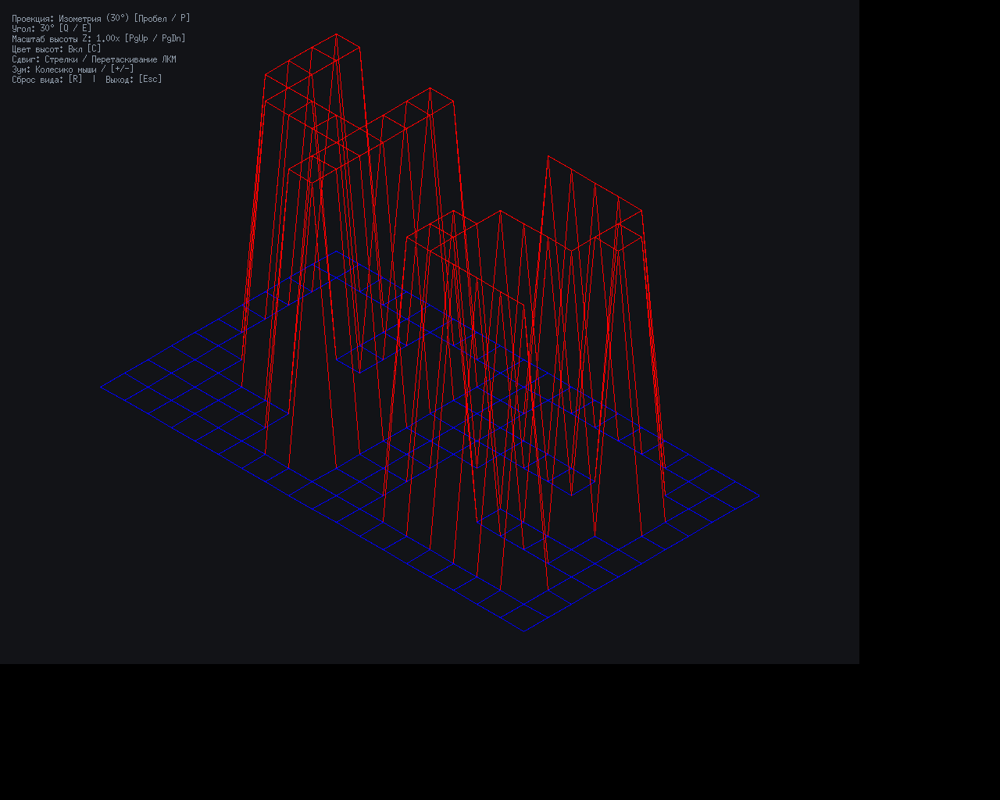

# FdF — каркасная 3D-модель карты высот




## Описание

**FdF** (Fil de Fer — с франц. «проволочный каркас») — программа для визуализации карт высот в виде трехмерной каркасной модели в изометрической и параллельной проекциях.

Программа считывает файл описания карты высот формата `.fdf`, строит регулярную координатную сетку в пространстве и проецирует ребра модели на двухмерную плоскость экрана в графическом окне.

## Требования и установка

- **Python**: версия 3.12 или выше.
- **Стандартная библиотека**: GUI построен на стандартном модуле `tkinter` (дополнительных runtime-зависимостей не требуется).
- **Инструменты разработки и тестирования** (опционально, для запуска тестов):
  - `pytest`
  - `mypy`
  - `ruff`

### Установка окружения разработчика

Для быстрой установки инструментов разработки можно использовать менеджер пакетов `uv` или обычный `pip`:

```bash
git clone https://github.com/egormswertik/fdf-python.git
cd fdf-python
pip install pytest mypy ruff
```

## Запуск

Программа запускается из терминала с передачей пути к файлу карты `.fdf`:

```bash
python main.py maps/elem.fdf
python main.py maps/42.fdf
python main.py maps/pyramide.fdf
```

- При неверном количестве аргументов выводится справка по использованию, а программа возвращает код `2`.
- При ошибке чтения файла или некорректном формате карты в `stderr` выводится диагностическое сообщение, и программа возвращает код `1`.

## Управление

Программа поддерживает интерактивное управление с клавиатуры и мыши:

| Действие | Управление |
|---|---|
| **Выход** | Клавиша <kbd>Esc</kbd> или кнопка закрытия окна |
| **Сдвиг модели (Pan)** | Клавиши со стрелками <kbd>←</kbd> <kbd>→</kbd> <kbd>↑</kbd> <kbd>↓</kbd> или зажатая левая кнопка мыши (Drag & Drop) |
| **Масштабирование (Zoom)** | Колесо мыши (фокус на курсоре) или клавиши <kbd>+</kbd> / <kbd>-</kbd> |
| **Масштаб высоты Z** | Клавиши <kbd>Page Up</kbd> / <kbd>Page Down</kbd> |
| **Вращение** | Клавиши <kbd>Q</kbd> (против часовой) и <kbd>E</kbd> (по часовой) |
| **Переключение проекции** | Клавиша <kbd>P</kbd> или <kbd>Пробел</kbd> (изометрия 30° / параллельный вид сверху) |
| **Градиент высот** | Клавиша <kbd>C</kbd> (переключение цветовой палитры высот) |
| **Сброс камеры** | Клавиша <kbd>R</kbd> (возврат к исходному масштабу и положению) |

## Архитектура

Проект строго декомпозирован на независимые модули по слоистой схеме:

```
[Файл карты .fdf]
       │
       ▼
 [fdf/parser.py]      → Читает и валидирует файл; генерирует MapFormatError
       │
       ▼
  [fdf/model.py]      → Структуры данных Point(x, y, z, color) и Map (сетка высот)
       │
       ▼
[fdf/projection.py]   → Камера, формулы изометрии, масштабирование fit() и интерполяция цвета
       │
       ▼
   [fdf/app.py]       → GUI на tkinter (единственный модуль, использующий графическую библиотеку)
       │
       ▼
    [main.py]         → Точка входа, разбор CLI-аргументов и обработка ошибок
```

1. **`fdf.exceptions`**: Иерархия исключений (`FdfError`, `MapFormatError`).
2. **`fdf.model`**: Хранение точек и топологии сетки. Предоставляет итератор по точкам и генератор соседей справа и снизу, гарантирующий построение каждого ребра ровно один раз.
3. **`fdf.parser`**: Чтение строк файла, разбор шестнадцатеричных цветов (включая короткую запись `0xFF`), валидация целостности матрицы высот.
4. **`fdf.projection`**: Формулы преобразования координат:
   $$x' = (x - y) \cdot \cos 30^\circ$$
   $$y' = (x + y) \cdot \sin 30^\circ - z \cdot z_{scale}$$
   $$X = x' \cdot scale + offset_x, \quad Y = y' \cdot scale + offset_y$$
   а также функции цветовой интерполяции `lerp_color` и `height_color`.
5. **`fdf.app`**: Графическое окно, обработка пользовательских событий и отрисовка каркаса.

## Тестирование и линтинг

Все модули (за исключением чисто графического интерфейса) полностью покрыты автоматическими тестами.

Перед отправкой изменений выполняются следующие проверки:

```bash
# Запуск тестов
pytest -q

# Строгая статическая типизация
mypy --strict fdf main.py

# Проверка стиля и качества кода
ruff check .
```
